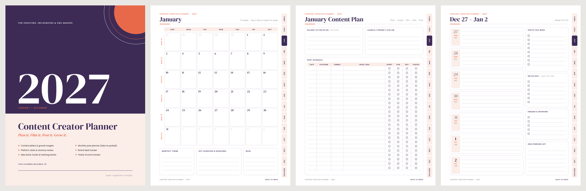
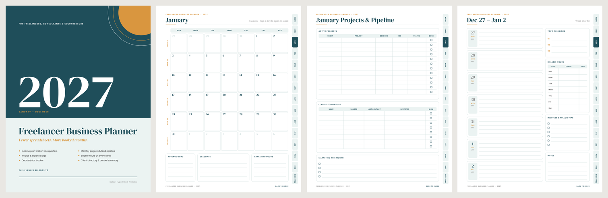
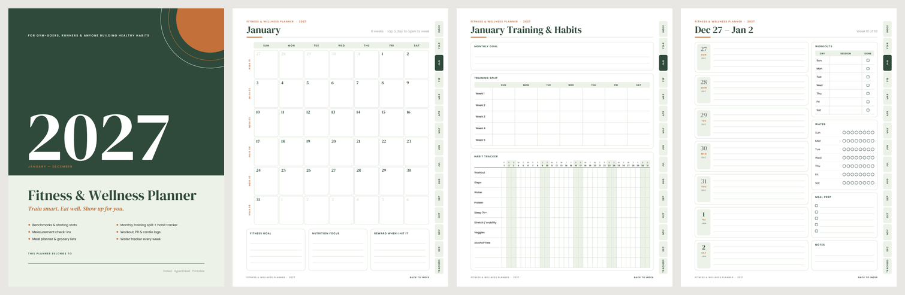
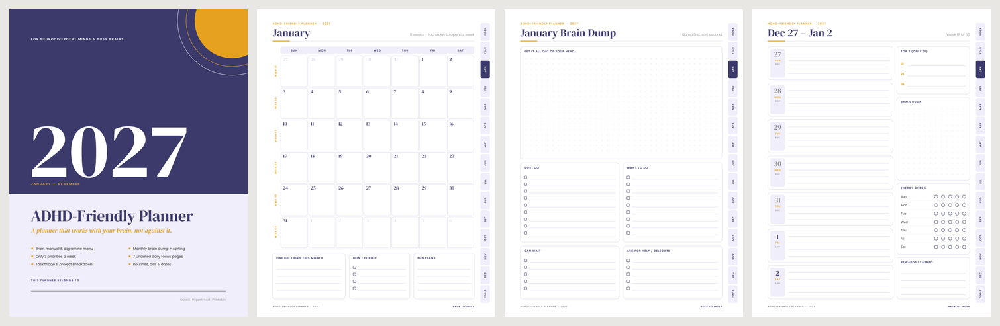
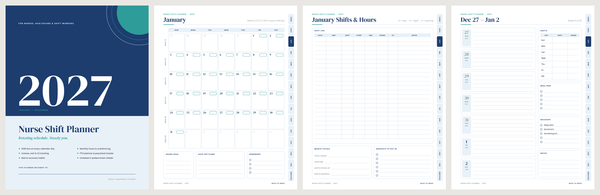

# 2027 Niche Planners

Five New Year planners, each built for one specific group instead of a generic "everyone" planner.
Every planner is a **dated, hyperlinked, printable PDF** for January to December 2027 (~105–111 pages).

| Planner | Who it's for | What makes it niche |
|---|---|---|
| **Content Creator Planner** | creators, influencers, UGC makers | content pillars, growth targets per platform, monthly post plan (idea → script → film → edit → posted), platform stats & revenue review, brand deal tracker, idea / hook / hashtag banks |
| **Freelancer Business Planner** | freelancers, consultants, solopreneurs | income goal broken into clients per quarter, monthly projects & lead pipeline, invoice & expense logs, billable hours every week, quarterly tax tracker, client directory |
| **Fitness & Wellness Planner** | gym-goers, runners, healthy-habit builders | benchmarks & starting stats, monthly training split, 31-day habit tracker, measurement check-ins, workout / PR / cardio logs, meal planner, grocery lists, weekly water tracker |
| **ADHD-Friendly Planner** | neurodivergent & busy brains | brain manual, dopamine menu, monthly brain dump then sort, only 3 priorities a week, tiny-habit tracker, 7 undated daily focus pages, task triage, project breakdown |
| **Nurse Shift Planner** | nurses, healthcare & shift workers | shift box on every calendar day, monthly hours & overtime log, license / cert / CE tracking, PTO planner, paycheck tracker, rest & recovery habits, undated 4-patient brain sheets |

## Download

Ready-made PDFs are in [`dist/`](dist/):

- `*-letter-sun.pdf`: US Letter, weeks start on Sunday
- `*-a4-mon.pdf`: A4, weeks start on Monday

## Previews

Cover · monthly calendar · niche monthly page · weekly page

**Content Creator**


**Freelancer**


**Fitness & Wellness**


**ADHD-Friendly**


**Nurse Shift**


## What's inside every planner

1. Cover
2. **Start Here** index: links to every month, year page and tracker, plus how to use it
3. Year at a glance (tap a month or a week to jump there)
4. Two niche year-planning pages (vision, goals, targets)
5. For each month:
   - a monthly calendar (tap a day to open its week)
   - two niche monthly pages (plan + review)
   - one weekly page per week, with a niche sidebar
6. Niche trackers / tools
7. Dot-grid notes

Navigation works in GoodNotes, Notability, Noteshelf, Xodo and any PDF reader: clickable side tabs
(Index, Year, Jan–Dec, Trackers) on every page, a "Back to index" link in the footer, and PDF bookmarks.
To print, choose "actual size" / 100%.

## Regenerate or customise

Requires Python 3.10+ and ReportLab (`pip install reportlab`).

```bash
python make_planners.py                         # all niches, 2027, Letter (Sun) + A4 (Mon) into dist/
python make_planners.py --list                  # show niche slugs
python make_planners.py --niche adhd-friendly --size a4 --week-starts sun
python make_planners.py --year 2028             # any year
```

- `planner/niches.py`: niche content: copy, colours, and page layouts built from `Box` / `Row` / `Cols`.
  To add a niche, copy one of the functions and register it in `ALL`.
- `planner/core.py`: drawing engine (tabs, links, boxes, tables, habit grids, calendars).
- `planner/build.py`: shared pages (cover, index, year, monthly, weekly, notes) and assembly.

## Fonts

[DM Serif Display](https://fonts.google.com/specimen/DM+Serif+Display) and
[Poppins](https://fonts.google.com/specimen/Poppins), both under the SIL Open Font License
(see `fonts/OFL-*.txt`). They can be embedded in PDFs you sell.

## Gumroad launch kit

`launch-kit/Gumroad-Launch-Kit-2027.zip` has everything needed to sell the planners on Gumroad:
product files (4 versions of each planner + quick start guides + a free sampler), cover images and
thumbnails, copy-paste listing text, pricing, discount codes, a launch calendar, email templates,
social captions and marketing images. Open `START-HERE.html` inside the zip first.

Rebuild it (about 35 seconds):

```bash
pip install reportlab pypdf pypdfium2 pillow
python -m launchkit.build_kit
```

- `launchkit/files.py`: planner variants, quick start guide, free sampler
- `launchkit/images.py`: covers, thumbnails, social posts, backgrounds (built from real page renders)
- `launchkit/copy.py`: listing copy for every product
- `launchkit/content/`: START-HERE guide template, offer codes, emails, captions, video shot list
